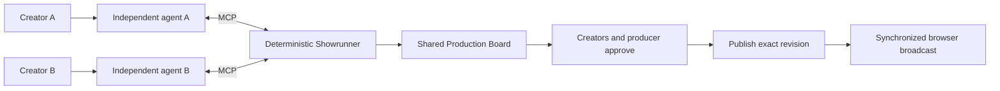

# ECHO Studio / EchoTV

**ბევრი შემქმნელი. ბევრი დამოუკიდებელი აგენტი. ერთი საერთო ეთერი.**

ECHO Studio-ში შემქმნელები საკუთარი AI აგენტებით ერთობლივად ქმნიან ტელევიზიას. აგენტები ათანხმებენ საეთერო დროს და აგვარებენ განრიგის კონფლიქტებს ავტორების პირობების დაცვით. საბოლოო გადაწყვეტილებას ადამიანები იღებენ: ეთერში მხოლოდ დამტკიცებული პროგრამა გადის.

**Hacktoberfest Georgia 2026 · Track 02: Multiplayer**

## Team / გუნდი

- Bacho Labadze — ბაჩო ლაბაძე
- Vato Mikaberidze — ვატო მიქაბერიძე
- Keti Mekoshkishvili — ქეთი მეკოშკიშვილი

ECHO turns independently created music, art and ideas into a shared broadcast. Each creator brings an independent AI agent; agents negotiate a common schedule while people retain approval and publishing authority.

## Start here, judges

`main` contains the tested **3.1 multiplayer broadcast core**, plus this submission documentation. Its application code matches [`echo-3.1-qa-passed`](https://github.com/bacholabadze/EchoTV/tree/echo-3.1-qa-passed) (`d0f4bd2`). All six product variations are preserved on separate branches below, with their development history.

- **Run the working multiplayer demo:** [quick start](#quick-start) and [full demo runbook](DEMO_RUNBOOK.md).
- **Inspect real agent collaboration:** [recorded Claude Code ↔ Codex runs](docs/evidence/2026-10-17-real-agent-series.md), including a partial concession and refusal to agree.
- **Explore the newer integrated studio:** [unified version and evidence](https://github.com/bacholabadze/EchoTV/blob/echo-unified-integration/docs/unified/REPORT_KA.md).
- **Explore the Georgian editorial experiment:** [editorial version and evidence](https://github.com/bacholabadze/EchoTV/blob/echo-editorial-wave/docs/editorial/REPORT_KA.md).

The repository is private; judges need repository access from its owner. This is source code and runnable local software, not a hosted live-demo URL.

## The problem and the working interaction

When creators share a channel, a longer segment can displace someone else's premiere. ECHO makes that coordination explicit: agents represent different creators' constraints, and a deterministic Showrunner checks whether the result fits.

The demo starts with a two-minute programme and a music premiere fixed at **0:50**:

1. Creator A asks their agent to extend an art gallery from 30 to 45 seconds.
2. ECHO offers 10 seconds of channel time, then asks Creator B's agent for the remaining 5 seconds.
3. B's agent may shorten its creator's introduction while protecting the premiere. A's agent adapts its gallery content to the agreed duration.
4. Both creators and the producer approve the exact proposal version in their own board sessions.
5. The producer publishes the approved revision and starts the broadcast. The premiere remains at **0:50**.

If an agent refuses, times out, or the people reject the proposal, the system preserves the existing programme. **NO AGREEMENT** is an explicit outcome.

## What makes it multiplayer

- **Independent agents:** Claude Code and Codex run as separate clients with separate credentials over MCP. Each receives its owner's instructions.
- **Shared constraints:** a deterministic scheduling core protects confirmed slots and routes requests between agents.
- **Human authority:** agents can propose, respond and revise; they cannot approve or publish.
- **Exact approvals:** approval is tied to a proposal version, segment revision and media fingerprint. Changing the content invalidates approval.
- **One broadcast:** viewers follow a common server clock and verify the exact published programme before playback starts.



## Versions and experiments

These branches document successive experiments, not six equally validated releases. The original commits and reports are retained so judges can inspect what changed and what each test actually demonstrated.

| Branch | What to explore | Evidence and limits |
|---|---|---|
| [`echo-3.1`](https://github.com/bacholabadze/EchoTV/tree/echo-3.1) · `d0f4bd2` | Independent-agent negotiation, per-person approvals, publication integrity, synchronized broadcast | Tested submission core. [Runbook](DEMO_RUNBOOK.md), [agent evidence](docs/evidence/2026-10-17-real-agent-series.md). |
| [`echo-3.2`](https://github.com/bacholabadze/EchoTV/tree/echo-3.2) · `41b67cd` | Creator interview, episode preparation and voice workflow | [Hybrid review](https://github.com/bacholabadze/EchoTV/blob/echo-3.2/docs/3.2/HYBRID_REVIEW.md). Earlier candidate; later integration addresses additional findings. |
| [`echo-visual-upgrade`](https://github.com/bacholabadze/EchoTV/tree/echo-visual-upgrade) · `e3529e7` | Studio visuals, gestures, listening reactions and event-driven camera cuts | [Visual review](https://github.com/bacholabadze/EchoTV/blob/echo-visual-upgrade/docs/visual-upgrade/REVIEW.md), [performance review](https://github.com/bacholabadze/EchoTV/blob/echo-visual-upgrade/docs/performance-wave2/REVIEW.md). Visual harness evidence, not a full broadcast acceptance test. |
| [`echo-visual-wave3`](https://github.com/bacholabadze/EchoTV/tree/echo-visual-wave3) · `53eae53` | Cinematic framing, camera motion, presenter refinements and optional opening | [Wave 3 review](https://github.com/bacholabadze/EchoTV/blob/echo-visual-wave3/docs/visual-wave3/REVIEW.md). Separate visual experiment. |
| [`echo-unified-integration`](https://github.com/bacholabadze/EchoTV/tree/echo-unified-integration) · `b0ee056` | Creator flow and visual waves combined, one entry point, fixed Georgian voice samples | [Integration report](https://github.com/bacholabadze/EchoTV/blob/echo-unified-integration/docs/unified/REPORT_KA.md). Real-agent integration evidence; automated human stand-ins; fixed samples are not dynamic Georgian speech. |
| [`echo-editorial-wave`](https://github.com/bacholabadze/EchoTV/tree/echo-editorial-wave) · `1b77352` | Georgian interface, agent-written editorial rundown, producer review and moderated audience Q&A | [Editorial report](https://github.com/bacholabadze/EchoTV/blob/echo-editorial-wave/docs/editorial/REPORT_KA.md). Experimental; presenters use captions in this format; independent QA and a real-guest rehearsal remain pending. |

To inspect another version without mixing its runtime state with the main demo:

```bash
git fetch origin
git worktree add ../EchoTV-unified origin/echo-unified-integration
cd ../EchoTV-unified
npm ci
```

Follow that version's linked report for its entry point and launcher. Do not reuse the same data directory across versions.

## Quick start

Requirements: **Node.js 22+**, npm, a modern browser, and **ffmpeg/ffprobe** for creator uploads and full media validation. To reproduce the real-agent negotiation, install and sign in to Claude Code and Codex. The viewer and board can be inspected without running agents.

```bash
git clone https://github.com/bacholabadze/EchoTV.git
cd EchoTV
npm ci
npm test
bash scripts/demo.sh start "Creator A" "Creator B"
```

The launcher prints private links for each creator and the producer, plus:

- Public read-only board: `http://127.0.0.1:8787/board/`
- Broadcast viewer: `http://127.0.0.1:8787/broadcast/`
- Standalone scripted 3D studio preview: `http://127.0.0.1:8787/studio/`

Open each person's private board link in a separate browser session. Follow [runbook sections 3–6](DEMO_RUNBOOK.md) for agent prompts, approvals, publication and playback. Click **Watch with sound** in the viewer. Stop with `bash scripts/demo.sh stop`.

Without the optional Piper installation, the broadcast outro uses captions. The [runbook](DEMO_RUNBOOK.md) documents the optional local voice setup. Keep the generated token links private; `data/`, its backups, local environment files and voice models are excluded from this submission checkout.

## Validation

```bash
npm test                    # 54 broadcast tests + 5 studio suites on the 3.1 core
npm run test:browser         # separate creator/producer sessions and approval flow
npm run test:browser-all     # full browser regression suite; Google Chrome required
```

Browser tests use isolated temporary server state and automate human actions. They do not establish that real people participated. The recorded [real-agent series](docs/evidence/2026-10-17-real-agent-series.md) uses actual Claude Code and Codex agents, with human approvals explicitly supplied by a test script. [Regression evidence](docs/evidence/2026-10-17-regression-d0e5ae5-fixes.md) describes the publication-start protection and failure scenarios.

[Submission preparation checks, 18 October 2026](docs/evidence/2026-10-18-submission-preparation.md): clean dependency installation, all 54 broadcast tests and 5 studio suites passed, plus the three-session browser approval/publication test.

## Technology and source map

| Area | Implementation |
|---|---|
| Server and shared state | Node.js, `node:http`, [server/server.mjs](server/server.mjs) |
| Scheduling and approval rules | [server/domain.mjs](server/domain.mjs), no LLM inside the rules engine |
| Agent gateway | MCP SDK + Zod, [server/mcp.mjs](server/mcp.mjs) |
| Live updates and playback | Server-Sent Events, browser media, shared server time |
| Studio rendering | Three.js / WebGL, [dist/studio](dist/studio) |
| Validation | Node test runner, Playwright, ffmpeg/ffprobe |
| Optional local voice | Piper; runtime and voice model not bundled |

## Build provenance and current scope

The pre-hackathon ECHO Studio visual prototype is preserved at baseline commit `c7eb068`. The 3.1 multiplayer work begins at `2618ebe` and reaches the tested checkpoint at `d0f4bd2`; it adds the negotiation core, MCP gateway, Production Board, approvals, publication and broadcast-integrity safeguards. Later experiment branches preserve the follow-on work.

The main demo uses attributed rehearsal art and a synthesized demo track. See [media attribution](media/ATTRIBUTION.md), [avatar attribution](dist/lab/assets/ATTRIBUTION.txt), and [scripted studio audio attribution](dist/studio/audio/ATTRIBUTION.txt). The standalone studio dialogue is authored demonstration material, not a live AI debate.

This is a local prototype. Public hosting, continuous 24/7 broadcasting and OBS/RTMP output are not implemented in the tested 3.1 submission. Newer editorial and voice experiments are identified separately in the version table.
